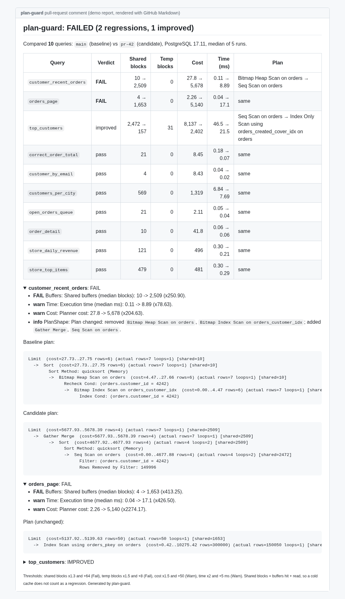
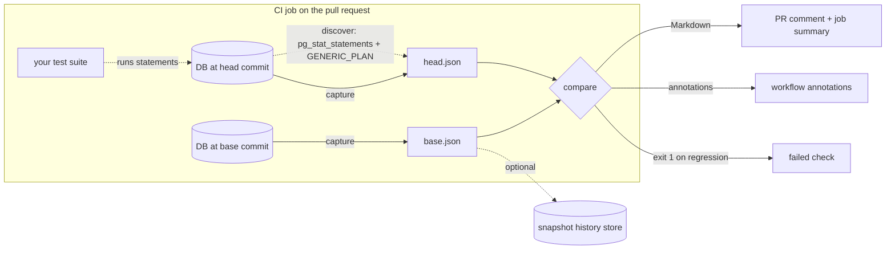

# plan-guard

[](https://github.com/hekimcan206/plan-guard/actions/workflows/ci.yml)
[](https://github.com/hekimcan206/plan-guard/actions/workflows/codeql.yml)
[](LICENSE)
[](global.json)

**A CI query-plan regression detector for PostgreSQL.** plan-guard captures `EXPLAIN (ANALYZE, BUFFERS)` plans
and `pg_stat_statements` counters for your queries on the base branch and on the pull request, compares them with
a noise-aware policy, fails the build and keeps one up-to-date comment on the PR when a change makes a query do
more work. It ships as a .NET tool, a container image and a GitHub Action.

> All data in this repository is synthetic; no real personal or business data is used anywhere.



<sub>The comment above is the report the demo produces, rendered by GitHub's own Markdown renderer
(`POST /markdown`) and captured with Playwright; see [How the screenshot was made](#how-the-screenshot-was-made).</sub>

## The problem

Most query performance regressions are not slow code, they are a **different plan**: a migration drops an index
that "nobody uses", a refactor wraps a column in a function, a query switches from keyset to `OFFSET`
pagination, a config change lowers `work_mem`. Reviews miss them because the diff looks harmless, and tests miss
them because tests check results, not plans. They surface in production as a dashboard that took 30 ms last
week and 3 s today.

Catching them in CI sounds easy: run `EXPLAIN ANALYZE` before and after, compare the time. It does not work. On
a shared runner the same query on the same data varies wildly: in this repository's lab a single-run timing
check would have failed **12 of 20 unchanged builds on a quiet host and 20 of 20 under load**. A check that cries
wolf gets disabled.

## What plan-guard does differently

It judges regressions on **work, not time**: the number of 8 KiB pages the executor touched (shared buffers
hit + read, median of five runs after a warm-up) and the pages it spilled to temp files. For a given plan and data
these numbers do not depend on the runner or the cache: in the lab they were identical in every run for 9 of 10
queries while single-run time varied up to 342x. Time and planner cost are still measured and shown, and warn;
plan-shape changes are reported with the operators that were removed and added.

| | Regressions caught (8 scenarios) | Unchanged builds failed (20 A/A, quiet / loaded) |
|---|---:|---:|
| Single-run `EXPLAIN ANALYZE` time, >1.2x | 7/8 quiet, 8/8 loaded | 12/20 / **20/20** |
| Median-of-5 time, >2x and +5 ms | 6/8 | 0/20 / 3/20 |
| Plan shape changed | 6/8 (misses OFFSET pagination, non-sargable filter) | 0/20 / 0/20, but fails improvements |
| **plan-guard default policy** | **8/8 in both conditions** | **0/20 / 0/20**, also 0/20 after a fresh `ANALYZE` |

Measured on PostgreSQL 17 with 300k synthetic orders, 2 CPUs; method, all seven detectors and raw numbers in
[docs/benchmarks.md](docs/benchmarks.md).

## How it works



```mermaid
sequenceDiagram
    participant PG as plan-guard capture
    participant DB as PostgreSQL (CI)
    PG->>DB: set_config(jit=off, statement_timeout), SET pg_stat_statements.track = 'all'
    loop each catalog query
      PG->>DB: BEGIN; EXPLAIN (VERBOSE, FORMAT JSON) q; ROLLBACK   (query id, plans without executing)
      PG->>DB: BEGIN; EXPLAIN (ANALYZE, BUFFERS, ...) q; ROLLBACK   (warm-up, not measured)
      PG->>DB: read pg_stat_statements row for the query id
      loop 5 runs
        PG->>DB: BEGIN; EXPLAIN (ANALYZE, BUFFERS, VERBOSE, SETTINGS, FORMAT JSON) q; ROLLBACK
      end
      PG->>DB: read pg_stat_statements again (delta = the 5 runs)
    end
    PG->>PG: median buffers / temp blocks / time, plan fingerprint, write snapshot JSON
```

Two ways to say which queries matter (ADR 0002), producing the same snapshot format:

- **`capture`** runs a **catalog**: one `.sql` file per important query, with representative literal values.
  Real executions, real buffer counts. Data-changing queries are measured inside rolled-back transactions.
- **`discover`** reads the statements your **own test suite** ran from `pg_stat_statements` and plans each with
  `EXPLAIN (GENERIC_PLAN)` (PostgreSQL 16+): no parameter values, nothing executed, no authoring.

The comparison (default thresholds, all configurable):

| Signal | Regresses when | Effect |
|---|---|---|
| Shared blocks (hit + read), median | > x1.3 **and** +64 blocks | **fail** |
| Temp-file blocks, median | > x1.5 **and** +8 blocks | **fail** |
| Planner cost | > x1.5 **and** +50 | warn (catalog), **fail** (discovered statements) |
| Execution time, median | > x2 **and** +5 ms | warn |
| Result rows changed | any change | warn (the numbers compare different work) |
| Plan shape | fingerprint differs | info, with operators removed / added |
| Query fails in the candidate | | **fail** |

## Why this design

- **Buffers over time** (ADR 0001): deterministic for a plan and its data, independent of cache state because
  hits and reads are summed, and they catch what plan diffing cannot (OFFSET pagination keeps the same plan
  and reads 413x more pages). Time stays visible as a warning so CPU-bound regressions are not silent.
- **Ratio and floor together**: the ratio alone fails a 4-block lookup that now reads 12; the floor alone ignores
  a 10x blow-up of a small query.
- **Catalog plus discovery** (ADR 0002): explicit queries give real runtime numbers for the hot paths; discovery
  covers everything the tests touched for free. Queries are matched by name or by a hash of their normalised
  text, never by `queryid`, which is derived from object OIDs and differs between two databases built from the same
  migrations.
- **Base and head captured in the same job** (ADR 0003): same runner, image, settings and seed data. Snapshots
  are versioned JSON, so capture and compare can also run in different jobs, and a PostgreSQL history store
  supports comparing against the latest `main` capture instead.
- **Safe execution** (ADR 0004): every EXPLAIN in a transaction that is always rolled back, one statement per
  file enforced by a lexer that understands dollar quotes and nested comments, `statement_timeout` on every
  session, settings applied with bound `set_config` parameters.
- **One comment per PR**: found by a hidden marker and only if the account behind the workflow `GITHUB_TOKEN` (user id 41898282) wrote it, so a planted marker
  cannot make the action overwrite someone else's comment. The comment degrades (plans, then details, then rows)
  to stay under GitHub's 65,536-character limit.

## Quick start

### The demo: `docker compose up`

```bash
docker compose up --build --exit-code-from demo demo
```

Starts PostgreSQL 17 with `pg_stat_statements`, seeds the synthetic shop database (300,000 orders, 900,000 lines;
about a minute), captures the catalog on `main`, applies a pull request that drops an index, switches a list to
`OFFSET` pagination and adds a covering index, captures again and prints the report. Measured output:

```text
plan-guard: FAILED (2 regressions, 1 improved)
baseline main  ->  candidate pr-42   (10 queries)
  FAIL     customer_recent_orders
           fail        Shared buffers (median blocks): 10 -> 2,509 (x250.90).
           warn        Execution time (median ms): 0.11 -> 8.89 (x78.63).
           warn        Planner cost: 27.8 -> 5,678 (x204.63).
           info        Plan changed: removed Bitmap Heap Scan on orders, Bitmap Index Scan on orders_customer_idx; added Gather Merge, Seq Scan on orders.
  FAIL     orders_page
           fail        Shared buffers (median blocks): 4 -> 1,653 (x413.25).
           warn        Execution time (median ms): 0.04 -> 17.1 (x426.50).
           warn        Planner cost: 2.26 -> 5,140 (x2274.17).
  IMPROVED top_customers
           improvement Shared buffers (median blocks): 2,472 -> 157 (-94%).
           improvement Execution time (median ms): 46.5 -> 21.5 (-54%).
           info        Plan changed: removed Seq Scan on orders; added Index Only Scan using orders_created_cover_idx on orders.
  PASS     correct_order_total
  PASS     customer_by_email
  PASS     customers_per_city
  PASS     open_orders_queue
  PASS     order_detail
  PASS     store_daily_revenue
  PASS     store_top_items
DEMO_OK plan-guard failed the PR on both regressions and reported the improvement

```

The PR-comment Markdown, the JSON report and both snapshots stay in the container:
`docker compose cp demo:/out ./demo-output`. `docker compose down -v` cleans up.

### As a GitHub Action

```yaml
- uses: hekimcan206/plan-guard@v1
  with: { command: capture, config: plan-guard.json, connection: "${{ env.DB }}", label: base, output: base.json }
# ... rebuild the database for the PR head ...
- uses: hekimcan206/plan-guard@v1
  with: { command: capture, config: plan-guard.json, connection: "${{ env.DB }}", label: head, output: head.json }
- uses: hekimcan206/plan-guard@v1   # fails the step on a regression, comments on the PR
  with: { command: compare, config: plan-guard.json, baseline: base.json, candidate: head.json }
```

A complete same-job workflow (PostgreSQL with `pg_stat_statements`, base worktree, rebuild, compare, artifact) is
in [docs/examples/plan-guard-pr.yml](docs/examples/plan-guard-pr.yml). The job needs `pull-requests: write` for the
comment; on fork PRs with a read-only token the comment is skipped with a warning and the verdict still applies.
This repository's CI runs the action exactly like that against the shop sample (`action-selftest` job).

### As a CLI

```bash
dotnet pack src/PlanGuard.Cli -c Release -o artifacts
dotnet tool install PlanGuard --tool-path ./tool --add-source ./artifacts

export PLANGUARD_CONNECTION="Host=localhost;Database=app;Username=ci;Password=..."
plan-guard capture  --config plan-guard.json --label base --out base.json
plan-guard capture  --config plan-guard.json --label head --out head.json
plan-guard discover --label head --out head-discovered.json      # after your tests ran (PostgreSQL 16+)
plan-guard compare  --baseline base.json --candidate head.json --config plan-guard.json --markdown report.md
plan-guard comment  --report report.md --pr 42                   # GITHUB_TOKEN and GITHUB_REPOSITORY from env
```

Exit codes: `0` no regression, `1` regression (or warning with `--fail-on warn`), `2` usage error, `3` runtime
error. `--store-connection` saves snapshots to a PostgreSQL history schema; `compare --baseline-label main` compares
against the latest stored `main`; `plan-guard history` lists them.

The container image runs the same CLI (`docker run --rm plan-guard:demo compare ...`). The chiseled image has no
Kerberos libraries, so add `GSS Encryption Mode=Disable` to connection strings used from it.

### Configuration (`plan-guard.json`)

```jsonc
{
  "queries": ["queries/*.sql"],      // one statement per file, named after the file
  "runs": 5, "warmups": 1,
  "statementTimeoutMs": 30000,
  "settings": { "jit": "off" },      // applied to every capture session
  "thresholds": { "bufferRatio": 1.3, "bufferMinDelta": 64, "timeGate": "Warn" },
  "ignore": [],                      // query ids to report but never judge
  "failOn": "Fail"                   // or "Warn"
}
```

Unknown keys are rejected, so a typo in a threshold cannot silently fall back to a default.

## Results

| Measurement | Result |
|---|---|
| Regression scenarios failed by the default policy | **8/8** quiet and loaded (dropped index, dropped FK index, non-sargable date, ILIKE vs expression index, partial-index mismatch, OFFSET pagination, work_mem spill, join without index) |
| Neutral changes failed (unrelated index, new column, re-ANALYZE, equivalent rewrite) | **0/4** in both conditions; covering index reported as improved (2,472 -> 157 blocks) |
| Unchanged builds failed, 20 A/A repetitions | **0/20** quiet, **0/20** loaded, also with a fresh `ANALYZE` before each capture |
| Same, single-run timing check (>1.2x) | 12/20 quiet, 20/20 loaded |
| Run-to-run variation of shared blocks vs single-run time | 0.00% (9 of 10 queries; 0.02% for a parallel aggregate) vs 13.5-158% CV quiet, up to 342x max/min loaded |
| Capture time, 10 queries x 6 executions | 0.59 s quiet, 2.28 s loaded (median) |
| Parse one EXPLAIN plan / compare + render 200 queries (BenchmarkDotNet medians) | 51.5 µs / 161 µs + 534 µs (compare was quadratic, 18.2 ms at 2,000 queries; indexed: 2.75 ms) |

Environment: i7-13620H, Docker Desktop on Windows 11, PostgreSQL 17.11 limited to 2 CPUs / 2 GB, host shared
with another build agent's workload. Details in [docs/benchmarks.md](docs/benchmarks.md).

## Tests

- **Unit** (139 tests): EXPLAIN JSON parsing on real PostgreSQL 17 fixtures, fingerprint invariance, plan diff,
  every comparison rule, report rendering against golden files, SQL statement splitting, the PR commenter
  against a fake GitHub API (including a planted marker), config validation and the CLI's exit codes.
  **FsCheck properties**: a capture compared with itself always passes; more buffers never give a better verdict;
  a value never regresses in both directions; semicolons inside literals never split a statement; concatenated
  statements are always detected.
- **Integration** (25 tests, Testcontainers): every lab scenario against the seeded shop database on
  PostgreSQL 17 (regressions fail their target, neutral changes pass, the improvement is reported), rollback of
  data-changing queries, a least-privilege login, statement timeouts, discovery with generic plans and a cost
  regression on a discovered statement, the history store, the CLI end to end, and capture plus discovery on
  PostgreSQL 16 and 18.

## Limitations and next steps

- **Test-sized data hides time regressions and can hide plan choices.** The planner picks plans from statistics;
  a 300k-row CI database does not plan exactly like a 300M-row production one. Seed production-*shaped* synthetic
  data, or load production statistics without data (for example with `pg_regresql`); never copy production rows.
- **CPU-bound regressions only warn.** A query that reads the same pages but burns more CPU (an expensive function
  in a filter, a hash join that grows in memory without spilling) shows up as a time warning, not a failure.
  `timeGate: Fail` turns it into a failure at the cost of more noise.
- **Generic plans are not custom plans.** Discovery's `GENERIC_PLAN` ignores parameter values; on skewed columns
  the server's custom plans may differ. Statements on temporary tables cannot be planned after the test run.
- **Catalog queries are trusted code.** A single statement can still call a function with side effects outside
  the rolled-back transaction (sequences, `dblink`). Use a disposable CI database and a least-privilege login.
- **Thresholds are reviewed code.** A pull request can loosen `plan-guard.json`; load it from the base branch in
  the workflow if contributors are untrusted (see `docs/threat-model.md`).
- **One lab schema.** 13 scenarios on one schema are evidence, not proof; the detection rates are counts.
- Next: plan history trends in the store (per-query sparkline in the comment), `auto_explain` import for
  queries that never run in tests, and a SARIF output so regressions appear in code scanning.

## How the screenshot was made

The demo's `report.md` was rendered to HTML with GitHub's Markdown API (`POST /markdown`, `gfm` mode), wrapped in
the public `github-markdown-css` stylesheet and captured with the Playwright container. It shows exactly the text
plan-guard posts; it is not a screenshot of a live pull request.

## Privacy

All data is synthetic and generated by `samples/shop/seed.sql`. plan-guard's reports contain SQL text and plan
structure (table, index and column names) but never result rows, so they are safe to post on a pull request for
code that is itself in the repository. Under KVKK (Turkey's personal data protection law) and GDPR, the
recommendation is the same as for any test environment: CI databases hold synthetic or anonymised data only.

## License

[MIT](LICENSE)
